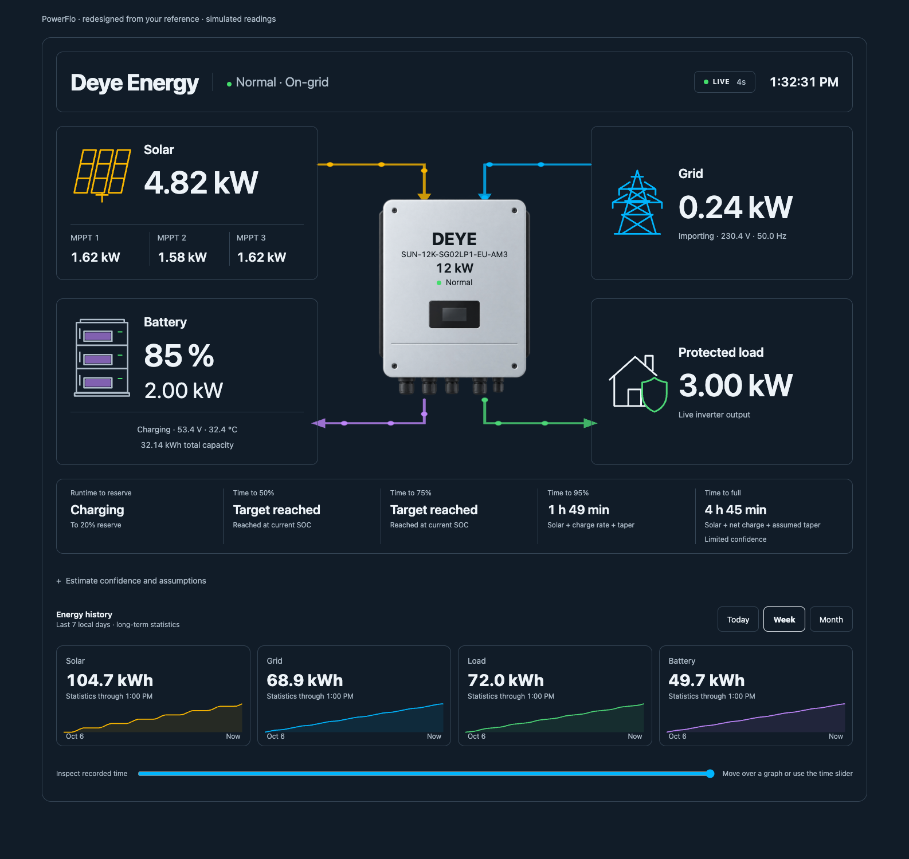

# PowerFlo

A transparent, read-only Home Assistant card for solar, battery, grid and load power flow. Map your existing entities, configure your system's ratings, and see what is supplying your loads now.



*Current development design; readings are simulated and demo controls are hidden. PowerFlo does not discover hardware, connect directly to an inverter or change inverter settings.*

## Features

- Reversible power-flow arrows, dynamic battery status and freshness-gated motion.
- Disconnected-grid presentation separate from unknown connection data and stale telemetry.
- Side-by-side battery SOC/power, with target and full estimates always visible. Runtime, milestones, confidence and assumptions remain in Battery details.
- Recent 15-minute protected-load trend, time-weighted average, observed peak and coverage labels.
- Today/Week/Month energy history with pointer, touch and keyboard observation inspection.
- Editable title, inverter name/model/image, inverter rating, battery capacity and solar-array nameplate size.
- Transparent theme-native surfaces, responsive layout, 12/24-hour clock and reduced-motion support.
- Single-file offline demo with simulated controls and system customization.
- System insights: estimate bands, conditional load runtimes, opt-in observed taper, BMS limits, solar/MPPT detail, power/energy proportions, diagnostics, outage history and density presets.
- Overnight readiness with local morning deadline, planning reserve, conditional morning SOC and explicit demand-data provenance.
- Independently switchable outage preparedness, opt-in equivalent-period chart overlays, and on-demand export/standby observations (Phase 2 development).
- Precision layout with open transparent zones, compact mobile inverter artwork and caption-safe flow lanes.
- On-demand Solar outlook: measured PV versus interval-mean forecasts, Today/Tomorrow, source selection, time inspection and hourly weather context.
- Battery estimate feedback: frozen target/reserve outcomes and separate 30-minute SOC checks, with explicit exclusions and optional browser-local retention.
- On-demand what-if load/capacity simulation that never changes installed settings.
- Editor-only guided entity mapping with role/sign confirmation and explicit review/save/cancel.
- Public Waveshare/Modbus commissioning guide and compile-verified read-only ESPHome profile, with live validation gates clearly separated.

Production source is JavaScript with no runtime package dependencies. The card reads through Home Assistant's existing authenticated frontend connection. It does not call services, write inverter settings or access Modbus directly.

## Compatibility is an entity contract

PowerFlo began with a Deye profile, but its display is integration-independent. Other inverter models can use it when their integrations expose the measurements below with the expected units and polarity. This is not a claim that every model or firmware has been tested.

Use aggregate solar, grid and protected-load readings. There are three optional PV-channel slots; the card is not a per-phase diagnostic display. Device protocols and register maps belong to your upstream integration.

**Set your real ratings before using estimates.** The retained 12 kW and 32.14 kWh defaults are example values for backward compatibility, not automatic detection. Solar size is a nameplate label, not measured generation or a forecast multiplier.

## Installation

Manual installation is supported. HACS metadata exists, but automated HACS distribution/installation has not been validated.

### 1. Get the files

Use both installation files from a [published release](https://github.com/flexyneat/PowerFlo/releases), when available for the version you want, or build the source checkout with Node.js 22+:

```bash
npm ci
npm run verify
```

The latest tagged release is **0.5.0**. This source includes unreleased Phase 2 and Phase 3 changes; the package version remains unchanged until a release is authorized. Build output (the versioned local demo contains the checked-out source, not necessarily a tagged release):

```text
dist/powerflo-card.js
dist/inverter-reference.png
dist/PowerFlo-demo-v0.5.0.html
```

Install the JavaScript and PNG together. The HTML is a demo, not an HA resource; the source map is optional. Source changes do not replace previously published release assets.

### 2. Copy into Home Assistant

Create `www/powerflo/` in your HA configuration directory:

```text
<config>/www/powerflo/powerflo-card.js
<config>/www/powerflo/inverter-reference.png
```

HA serves `www/` files under `/local/`. If you have just created `www/` for the first time, restart HA so it recognises the directory. See the [official custom-card documentation](https://developers.home-assistant.io/docs/frontend/custom-ui/custom-card/).

### 3. Register the module

Enable Advanced mode in your user profile. Open **Settings → Dashboards**, then **Resources** in the three-dot menu. Add `/local/powerflo/powerflo-card.js?v=0.5.0` as a **JavaScript module**. For YAML-managed resources:

```yaml
lovelace:
  resource_mode: yaml
  resources:
    - url: /local/powerflo/powerflo-card.js?v=0.5.0
      type: module
```

Use the resource-management method matching your dashboard setup; avoid duplicate registrations. See [resource registration](https://developers.home-assistant.io/docs/frontend/custom-ui/registering-resources/) and [dashboard resource modes](https://www.home-assistant.io/dashboards/dashboards/).

### 4. Add your card

Use the visual editor or a manual card. Replace every example entity ID with one from your installation:

```yaml
type: custom:powerflo-card
title: Home energy
inverter_name: My inverter
inverter_model: My model
inverter_capacity_kw: 8
battery_capacity_kwh: 20
solar_capacity_kw: 10.5
battery_positive: discharge
grid_positive: import
battery_reserve_soc: 20
battery_charge_target_soc: 95
entities:
  freshness: binary_sensor.inverter_telemetry_fresh
  inverter_status: sensor.inverter_status
  grid_connected: binary_sensor.grid_connected
  solar_power: sensor.solar_power
  battery_soc: sensor.battery_soc
  battery_power: sensor.battery_power
  grid_power: sensor.grid_power
  load_power: sensor.protected_load_power
```

## Entities and units

| Required key | Expected value |
| --- | --- |
| `freshness` | A trustworthy boolean for current telemetry, not an always-on helper |
| `inverter_status` | Optional readable operating-status text; unmapped displays Unavailable |
| `grid_connected` | Optional boolean connection state; unmapped displays connection unknown and pauses grid flow. Never infer it from zero import |

An unmapped grid connection now displays **Connection unknown**, with reported voltage where available. Voltage detection alone does not certify the inverter relay is connected. Transparent quadrant borders inherit the dashboard theme. To embed the full card in another dashboard, add a **panel view** with this same card configuration; existing dashboard views need not change.
| `solar_power` | Aggregate generation, W |
| `battery_soc` | SOC, % |
| `battery_power` | Signed battery-side power, W |
| `grid_power` | Signed grid power, W |
| `load_power` | Protected-load demand, W |

Boolean aliases include `on/off`, `true/false`, `connected/disconnected`, `online/offline`, `1/0` and `yes/no`. Unknown data is not false; blank numeric data is not zero. The card depends on your integration's freshness signal and cannot independently prove hardware connectivity.

With `battery_positive: discharge`, positive watts mean discharge and negative watts mean charge. With `grid_positive: import`, positive watts mean import and negative watts mean export. Reverse these options when your source uses the opposite convention.

Optional mappings go inside the same `entities` object:

| Key | Unit / purpose |
| --- | --- |
| `pv1_power`, `pv2_power`, `pv3_power` | W, PV-channel power |
| `battery_voltage`, `battery_temperature` | V and °C |
| `grid_voltage`, `grid_frequency` | V and Hz |
| `solar_today`, `grid_today`, `load_today`, `battery_today` | kWh, daily energy counters |
| `solar_forecast_power` | W, optional average future solar supply—not a daily kWh forecast |

Choose counters deliberately: import is not net grid energy, and battery discharge is not charging energy. Summary labels do not change the meaning of your source counters.

## System customization

The native editor exposes the fields below, image upload and entity/statistic mappings. Text is rendered as text, not HTML.

| Option | Default | Purpose |
| --- | --- | --- |
| `title` | `PowerFlo` | Title, up to 60 characters |
| `inverter_name` | `Inverter` | Name/brand, up to 40 characters |
| `inverter_model` | Empty | Model, up to 80 characters; hidden when empty |
| `inverter_capacity_kw` | `12` | Rated AC power label, 0.1–1,000 kW; set your rating |
| `battery_capacity_kwh` | `32.14` | Effective energy for estimates, 0.1–10,000 kWh; update after expansion |
| `solar_capacity_kw` | `0` | DC array nameplate in kWp, 0–10,000; zero hides it |
| `inverter_image` | Empty | Default illustration or supported local/raster data URL |
| `clock_format` | `"12"` | AM/PM or `"24"`; HA timezone |
| `battery_positive` / `grid_positive` | `discharge` / `import` | Positive-power meanings |
| `flow_threshold_w` / `flow_release_w` | `40` / `20` | Activation and battery/grid release thresholds; release cannot exceed activation |
| `battery_reserve_soc` | `20` | Runtime reserve, 0–100%; not an inverter command |
| `battery_charge_target_soc` | `100` | Charging estimate goal, 1–100% |
| `runtime_window_minutes` | `5` | Averaging window, 1–60 minutes |
| `runtime_max_sample_age_seconds` | `60` | Battery sample age/gap limit, 5–300 seconds |
| `charge_taper_start_soc` | `90` | Assumed taper start, 50–99% |
| `charge_taper_floor_ratio` | `0.2` | Assumed power ratio at full, 0.05–1 |
| `solar_projection_hours` | `4` | Supply horizon, 0–24 hours; capped at sunset when available |

Upload PNG/JPEG/WebP up to 2 MB and 4096 × 4096 pixels. The image is embedded in card configuration. Alternatively use a raster image under `www/` with a `/local/` path. External URLs, active URLs and SVG uploads are rejected. Use transparent PNG/WebP if you want the image itself to blend into the dashboard.

Panels are transparent and shadow-free. Text/borders inherit HA theme variables. Themes can override `--powerflo-solar-color`, `--powerflo-grid-color`, `--powerflo-battery-color`, `--powerflo-load-color` and `--powerflo-disconnected-color`; check contrast against your background.

## Grid states

| Condition | Display |
| --- | --- |
| Fresh connection true and numeric power | Importing, exporting or static, with measured power |
| Fresh connection false | Red **Disconnected** and a red X on the desktop grid connector; no grid flow, and retained measurements are not shown as live |
| Fresh connection unknown | **Unavailable**; connection unknown and flow paused |
| Stale/unavailable telemetry | **Stale/Unavailable**; last-reported connection labelled and flow paused |

A disconnected port is not automatically proof of a utility outage. The card reports your mapped connection entity. Zero power on a connected grid stays Static, not Disconnected. The X is hidden for unknown or stale telemetry; compact layouts omit connector lines but keep the textual disconnect status.

## Battery forecasts

Both target/full estimates remain visible. A configured goal below 100% is used for the target column; with a 100% goal, the intermediate target is 95%. Full independently projects to 100%. Reaching 95% does not mark full as reached.

Runtime is effective capacity × `(SOC − reserve) / 100`, divided by smoothed battery-side discharge power. Charging uses measured net charge, solar-supply assumptions and configurable upper-SOC taper. Net charge already includes solar; solar is not added twice.

While charging or idle, runtime says Not discharging and labels the discharge reserve separately. During discharge it shows duration until that reserve. Battery details retains 50/75/95 milestones, the configured-goal forecast, runtime, confidence and assumptions.

Confidence describes observation quality, not a calibrated probability of finishing on time. Missing/stale samples pause estimates. Taper and future solar are assumptions, not battery specifications. Keep capacity and assumptions accurate; none of these settings change actual inverter charging behavior.

## History and recent demand

Today uses daily-energy Recorder samples from HA local midnight plus fresh endpoints. Week covers seven local calendar days including today; Month starts at local midnight on the first of this month. Week/Month use completed hourly long-term energy statistics, not guessed raw-power totals.

If statistics IDs differ from your daily-counter entities, configure them explicitly:

```yaml
statistics:
  solar: sensor.solar_energy_total
  grid: sensor.grid_import_energy_total
  load: sensor.load_energy_total
  battery: sensor.battery_discharge_energy_total
```

Statistics need energy units and sum support. Missing hours/counters are labelled partial; statistics paths split at gaps. The unfinished hour is not extrapolated. Inspect observations with pointer/touch or the keyboard time slider; Escape clears inspection.

Recent demand is a separate trailing 15-minute window of `load_power`. Average is time-weighted over covered intervals; peak is the maximum trustworthy observation. Recorder backfills one entity at most once per minute per card. A reading holds to the next state but for no more than 60 seconds. Missing time is not zero demand or an indefinite hold. Partial averages show coverage; failures retain observed samples and expose a retry independent of energy-history retry.

## Offline demo

```bash
npm run build:demo
```

Share `dist/PowerFlo-demo-v0.5.0.html` alone. JavaScript, styles, the PNG and MIT notice are embedded. Open it in a browser without a server, HA, Node or internet. Email previews may not run JavaScript; download and open the file instead.

Try battery modes, connected/disconnected/unknown/stale grid states, periods and chart inspection. The **Off-Grid** preset simulates a fresh outage: grid flow and solar production stop, and the battery supplies the protected load. Choosing another battery mode restores the connected-grid example; choosing another grid state exits the outage preset.

Appearance follows the system light/dark preference initially. The sun/moon button switches between light and dark; after a manual selection, system changes no longer override it. Reload to return to automatic appearance. Customize system exposes the native editor for identity, ratings, battery/solar size, image and behavior. Preview settings stay in memory: they are not saved into the HTML or sent to hardware. Use raster upload rather than an HA-only image URL when offline.

The fixture is labelled simulated and has no live HA connection or credentials. Its Content Security Policy blocks external connections/assets. Review any local fixture edits before sharing. The HTML is not an HA installation resource.

Battery/Grid scenario dropdowns and the sun/moon button belong only to the demo, outside the card. They are not rendered on the installed Home Assistant card, which follows HA's theme and mapped live entities. The normal card editor's configuration fields remain available when editing a dashboard.

## Update and troubleshoot

Replace both installation files, change the module's cache key to the installed version, and reload the frontend/companion app cache. Custom element missing? Check the resource URL and browser console. Image missing? Keep the PNG beside the JS or check your custom path.

Reversed arrows? Verify polarity against source readings. Grid unavailable? Check connection mapping rather than substituting zero. Estimates not warming up? Check freshness, battery timestamps and at least 30 seconds of continuous samples. Empty graphs? Check Recorder inclusion, units and sum-capable statistics. Never post tokens, passwords or private readings in an issue.

To uninstall, remove the card and resource, then its two installed files. No inverter configuration needs undoing.

## Development and limitations

`npm run verify` runs ESLint, Vitest coverage, Rollup and the offline exporter. Source is in `src/`, tests in `test/`, the fixture in `demo/`, and export tooling in `scripts/`. Build output is Git-ignored. No TypeScript or runtime frontend library is required.

Automated/simulated checks are not hardware commissioning. Validate your live HA instance, entity mappings, statistics and battery taper assumptions. The card does not increase upstream polling or make a stale integration live.

## License and artwork

MIT; see [LICENSE](LICENSE). Copyright © 2026 PowerFlo contributors. Keep the copyright and permission notice when redistributing software; the generated demo and production JS include it.

The transparent PNG is an AI-generated illustration, not an official manufacturer photograph, enclosure specification or certification. Model/name labels are user configuration; PowerFlo claims no manufacturer affiliation.

## System insights (0.4.0)

Open **System insights** for advanced detail; both target/full estimates stay visible in the battery card. Set `density` to `compact`, `standard` (default), or `expanded` in YAML/editor. Compact reduces spacing, not essential readings; expanded opens insights initially.

| Feature | Behavior and boundary |
|---|---|
| Estimate bands | Inverse-rate scenarios using observed rate variation (10–75% spread); not calibrated probability intervals. Non-ready states have no numeric band. |
| Load runtime scenarios | Capacity above reserve × `runtime_load_efficiency` ÷ current/average/peak AC load. Efficiency defaults to 0.9, configurable 0.5–1. No future solar/load growth; missing/zero load stays unavailable. |
| Observed taper | Session-only, bounded low/high-SOC sample fitting with stable observed supply. `use_learned_taper: false` is default; true uses qualified learning or configured fallback. Not BMS characterization; no cross-reload persistence. |
| BMS current indicators | Optional `battery_current`, `bms_charge_current_limit`, `bms_discharge_current_limit` in A. Near-ceiling label at ≥95% of relevant reported limit. No current limits changed. |
| Solar utilization | Instantaneous fresh W / installed kWp nameplate. Not efficiency; can exceed 100%. |
| MPPT detail | Existing three power slots plus optional `pv1_voltage/current` through `pv3_voltage/current` in V/A. Unmapped/stale channels remain unavailable. |
| Supply / energy mix | Instantaneous PV/import/discharge proportions. Set `energy_sources_verified: true` only after confirming counter roles to also show Today/Week/Month gross-energy proportions. Storage cycling can double-count energy; neither is routed-load attribution. Inspect partial statistics/coverage. |
| Data-quality diagnostics | Required mappings, numeric values, units, live numeric timestamps and history coverage. Transition-only binary/status entities are not falsely aged by last change. Polarity still requires physical validation. |
| Outage timeline | Trailing 24-hour Recorder reads of connection AND freshness, at most once/minute, plus live-session observations. Unknown intervals are partial; missing records do not prove no outages. |
| Density presets | Accessible native disclosure with responsive spacing. Installed card has no demo scenario dropdowns or theme toggle. |

Learning needs three distinct charging samples below the configured taper start and three at ≥95% SOC. Duplicate timestamps/unstable supply (>10% source change) are excluded; telemetry gaps/backward SOC reset the session. Qualified rate-floor fitting is clamped 0.05–1 and affects estimates only when opted in. Inferences may reflect source/BMS constraints, not battery chemistry.

## Overnight readiness, simulator and guided setup (0.5.0)

These additions preserve both Battery estimates, existing features, transparent surfaces and JavaScript-only read-only behavior. No new Modbus registers are required. Configure your **actual installed total kWh**; the demo illustrates one 16 kWh battery. A hypothetical expansion never changes installed capacity. Per-battery-pack visibility is not included.

```yaml
readiness_enabled: true          # legacy master switch: readiness AND simulator
preparedness_enabled: true       # false hides preparedness only; simulator stays available
readiness_deadline: "06:00"       # Home Assistant local time, not the browser's zone
readiness_average_w: null         # blank/null uses observations; 0 means a real zero-load assumption
readiness_min_coverage: 0.8       # accepted historical coverage, range 0.5–1
battery_capacity_kwh: 16         # set your actual installed total
battery_reserve_soc: 20          # reused planning reserve, not an equipment command
runtime_load_efficiency: 0.9     # effective usable-energy factor including losses/overhead once
```

### Overnight readiness

The compact row below the flow diagram estimates supply until the morning deadline **if grid supply fails now** (or remains off), with **no future solar or grid charging credited**. It is energy planning, not a backup guarantee, shutdown setting or compressor-surge/BMS power assessment. Open **Preparedness details** for usable energy above reserve, required energy, conditional margin/shortfall, telemetry and assumptions. Power/surge capability remains **Not assessed**: the energy calculation cannot certify it. Fresh SOC in % and fresh telemetry are required; missing/invalid values remain unavailable, not zero.

In the visual editor, **Show outage preparedness → Hide preparedness; keep simulator** sets `preparedness_enabled: false`. This hides the readiness row and preparedness details; the simulator remains a standalone disclosure, and both Battery estimates remain visible. `readiness_enabled: false` retains its legacy meaning and hides both readiness and the simulator. These are display preferences, not battery or inverter commands.

Demand precedence: explicit manual watts; otherwise a qualified three-day matching-local-time profile; otherwise a sufficiently covered recent 15-minute average; otherwise fresh instantaneous demand. Fallbacks are labelled and are not presented as overnight historical profiles. Each required half-hour historical bucket needs configured coverage and observations on at least two local dates. Unknown values and gaps beyond 60 seconds remain uncovered. Slow-reporting sensors may therefore use fallback. Recorder must include the mapped protected-load sensor; forced numeric updates can improve coverage but increase storage.

One filtered protected-load history read covers three days, at most hourly while visible; manual mode skips it. User retries are paced at least one minute apart. Configuration changes/detachment invalidate late responses. Missing/invalid HA time zones make estimates unavailable. The deadline uses HA local calendar and real elapsed time through midnight/DST. A passed deadline moves to the next local day; a nonexistent DST clock uses the first valid minute after it, and repeated clocks use the first occurrence on the selected day.

Usable AC energy above reserve is `capacity_kWh × max(0, SOC − reserve_SOC) / 100 × effective_factor`; demand is `average_AC_watts × hours / 1000`. Morning SOC is `SOC − 100 × demand_kWh / (capacity_kWh × effective_factor)`. Displayed SOC clamps to 0–100 but reserve shortfall is separately retained. Do not subtract standby loss twice when already included in the factor. Capacity aging and future demand remain assumptions.

Illustration only: one 16 kWh battery, 95% SOC, 20% reserve, assumed 0.9 factor and eight hours at 1.20 kW -> 10.8 kWh above reserve, 9.6 kWh demand and about 28% morning SOC. This is not measured battery performance.

### What-if simulator

Open **Explore scenario** for extra average watts, hypothetical total capacity, reserve and deadline. Compare baseline/scenario morning SOC, time to reserve and reserve shortfall. The baseline follows live telemetry; both results use the same scenario deadline. Hypothetical expanded storage starts at current SOC. The example above plus 100 W average gives about 23%; hypothetical 32 kWh gives about 59%.

Inputs are ephemeral, not persisted or passed to equipment or saved configuration. Reset restores scenario defaults. Blank/invalid inputs produce an error instead of a misleading result. All current readings and both Battery estimates remain accessible. Average extra watts are not compressor running/startup watts; representative measured kWh/day is preferable for appliances.

### Guided entity setup

In the visual editor, expand **Guided entity setup**: select candidates, check representations/physical roles and power signs, then explicitly save reviewed mappings. This emits HA's normal `config-changed` display event; the dashboard's own Save action still applies. Cancel discards the isolated draft. Existing direct fields/YAML, optional mappings, identity, image and ratings remain supported. No equipment settings are changed.

Candidates come from existing HA entities, never physical device discovery, and are not auto-applied. Required power is W, SOC is %, and connection/freshness use explicit boolean binary sensors. Convert upstream if needed; no silent scaling. Duplicate roles, incompatible units, invalid values and unavailable entities are flagged. Save requires independent role and sign confirmation; value/unit compatibility is not commissioning proof. Zero watts never proves grid disconnection. Do not interrupt live wiring to verify roles. Optional data can stay unmapped. Neither the guide nor demo scenario dropdowns appear on the everyday installed card.

## Phase 2: comparisons and grid insights (unreleased)

### Equivalent-period comparisons

Select **Compare previous period** beside Today/Week/Month. It defaults off and makes no reference-history requests until enabled. Solid is current; dashed is the reference, on the same energy and time scales. Summaries retain their existing current-period totals. A compact kWh delta refers only to the comparable recorded window, whose cutoff is shown above the charts. The time slider, pointer, touch inspection, missing-data treatment and all existing views remain available; inspection adds the nearest reference observation, not an interpolated reading. Zero references never produce an infinite percentage.

- **Today:** yesterday through the same Home Assistant local clock time. Recorder comparisons accept Wh/kWh/MWh counters; missing units, unknown states, unexpected resets, large gaps, sparse boundaries or unmatched endpoints withhold the delta. No midnight measurement is invented.
- **Week:** the existing rolling seven-local-calendar-day window versus its preceding equivalent window. This is not a calendar-week report.
- **Month:** month-to-date versus the corresponding prior-month window. If the previous month lacks the current date, comparison clips to their common calendar dates and discloses that cutoff; the main current total is unchanged.
- **Week/Month** use validated energy statistics with sum support, in completed hourly changes. No unfinished-hour extrapolation. Gaps or unequal covered endpoints withhold deltas.
- If DST makes the windows unequal in real duration, comparison is explicitly unavailable; no hour is duplicated, stretched or silently estimated. Current charts continue normally. This conservative limitation is deliberate.

Comparison reads use the existing authenticated HA Recorder/WS APIs and only the four mapped energy IDs, two equivalent windows per refresh. Results are bounded to three cached contexts, refreshed at most once per ten-minute bucket during normal visible use. Explicit retries are limited to once/minute; configuration, period, units and timezone changes invalidate the relevant context. Late responses are discarded after configuration changes, disabling comparison or detachment. Today reference parsing is capped at 10,000 rows per series and conservatively marks truncated coverage partial. Recorder retention and statistics access still determine availability.

### Export observations

Open **Grid insights** inside the Grid card. It expands below the topology; no extra diagnostic tiles are permanently added. Escape closes the disclosure and returns focus to its Grid button. The installed card contains no demo battery/grid selectors.

```yaml
grid_power_verified: false       # true ONLY after checking physical role and configured sign
grid_positive: import            # existing sign setting; use export only for opposite-polarity sensors
export_threshold_w: 50           # example observation threshold, not a zero-export setting
export_duration_seconds: 300     # example continuous duration, range 30–86400 seconds
standby_measurement_verified: false
standby_assumed_w: null          # optional informational assumption; blank/null means unknown
entities:
  # Merge into your existing mappings; do not replace required entity mappings.
  inverter_standby_power: ""     # optional qualified inverter-only idle sensor, W or kW
```

Export detection stays unverified until physical grid-point role and sign are confirmed. Fresh heartbeat/numeric power reports and an explicit connected-grid state are required. A transition-only connection binary is not falsely aged by its last-change time. Duplicate report timestamps do not accrue time; import/below-threshold chatter, gaps beyond `runtime_max_sample_age_seconds`, unknown/stale data and disconnection interrupt qualification. An event is counted once when continuous observed export exceeds the threshold for the configured duration. The aggregate exported energy integrates only observed intervals whose two endpoints both exceed the threshold; this is a bounded session observation, not a utility-meter total or an exact crossing-time measurement.

Coverage and event counts are **live-session only**, cleared by real configuration changes or detachment/reload. “No qualifying session events” does not prove zero export outside covered intervals. No Recorder export-event backfill is claimed. These insights neither inspect nor change Solar Sell or zero-export settings; do not infer inverter configuration or regulatory compliance from them.

### Standby-loss insight

Default is **Not assessed**. Never substitute `PV + grid + battery − load` for measured standby loss: AC/DC scope, conversion losses, measurement timing and omitted circuits invalidate that shortcut.

For a measured value, map a dedicated inverter-only idle-power sensor and set `standby_measurement_verified: true` only after validating its scope. The upstream sensor must report unavailable outside qualified idle conditions; this card cannot infer physical isolation or certify an arbitrary sensor's scope. Units must be W/kW, nonnegative, and its timestamp must be fresh. Alternatively enter `standby_assumed_w` as a clearly labelled **manual assumption**, never measured performance. A qualified measurement takes precedence; otherwise an explicit manual assumption can be shown.

The 24-hour kWh equivalent is `watts × 24 / 1000`, conditional on that same draw all day—not recorded daily consumption. It is informational only and is **not** subtracted from runtime/readiness, whose effective usable-energy factor already includes overhead once. No new unvalidated Modbus register is added for standby, grid state or BMS capability. Per-pack visibility remains excluded.

### Verification scope

The test suite covers equivalent local windows, short months, DST refusal, zero/missing/partial references, Wh conversion, gaps/resets, request cancellation/cache, threshold/duration chatter, duplicate timestamps, stale/disconnected data, standby provenance, display toggles and both battery estimates. The offline export embeds the same card and assets under a network-blocking CSP. Browser/theme/mobile/offline checks validate the simulated fixture; live HA/Waveshare/inverter commissioning remains a separate acceptance gate. This frontend update changes no equipment settings and does not certify exact-firmware register semantics.

## Solar outlook and weather

Open **Solar outlook** in the Solar zone. Today/Tomorrow and the time slider belong only to this solar timeline; existing Today/Week/Month energy history and comparisons remain unchanged.

1. Configure [Forecast.Solar](https://www.home-assistant.io/integrations/forecast_solar/) upstream using the **installed** array's capacity, tilt, azimuth and HA location. Model differently oriented planes appropriately. Three MPPT readings do not automatically create three forecast planes.
2. Under **Settings → Dashboards → Energy → Solar panels**, enable solar-production forecasting and select the matching source.
3. Open Solar outlook and select only this system's matching array(s). Empty selection deliberately produces no total. Copy the displayed source IDs into card settings to retain them; session selections never change HA Energy preferences.
4. Optionally map an hourly-capable weather entity, such as Met.no `weather.forecast_home`. No API keys or provider credentials go into PowerFlo.

```yaml
# Merge into your existing card; retain its required entities.
solar_outlook_enabled: true
solar_forecast_sources: []  # replace with source IDs listed in Solar outlook
weather_entity: weather.forecast_home
estimate_accuracy_enabled: true
accuracy_storage_key: main_system  # unique per system/card for browser retention
```

Forecast.Solar already incorporates weather upstream. Met.no provides context, not a second cloud/rain multiplier. Weather alone cannot manufacture a kWh forecast. PowerFlo uses native read commands `energy/solar_forecast` and `weather/subscribe_forecast` on the existing authenticated HA connection—not service actions, equipment commands or direct vendor requests.

The chart separates **solid measured PV power** from **dashed forecast interval-mean power** on shared W/time scales. A Now marker separates past/future; HA-zone local days respect DST. The Energy adapter's start-keyed `wh_hours` values are Wh per interval, divided by actual elapsed duration for mean W. The next timestamp bounds each interval. Terminal intervals without a known end and gaps over one hour are withheld, not extrapolated. Missing/invalid measured reports and observation gaps over 15 minutes break the measured trace. No fake curve is drawn from a daily total.

Remaining PV energy includes only covered future intervals; partial current intervals are prorated under a uniform mean-power assumption. Multi-array totals may have partial array coverage; the inspector reports the number of selected arrays covering that time. This is forecast **PV production**, not guaranteed battery charging. No probability band is invented. Provider issue time is unknown in this API; local receipt does not prove upstream freshness.

Reads are lazy while detail is open and the card/page is visible. Energy normally refreshes hourly, measured PV history every five minutes, with bounded 15-second waits and late-response rejection. Weather subscriptions stop on close, hidden/background state, configuration change and detach. Forecast receipts over two hours old are withheld. Explicit Refresh retries missing data; integration cadence and native API compatibility remain upstream dependencies. Unsupported weather, unassociated arrays and read failures show guidance without disabling live readings/estimates.

**Battery calculations are preserved.** The existing optional scalar `entities.solar_forecast_power` retains its existing projection role. The new overlay does not silently replace target/full estimates, credit gross PV as battery charging, double-count solar, add future grid charge or relax preparedness's no-future-solar baseline. Interval-assisted battery planning would require separately approved assumptions.

## Estimate accuracy feedback and privacy

Open **Battery details → Estimate accuracy**. Real first use says **Collecting qualified outcomes**, never a fabricated accuracy percentage. This is feedback, not automatic calibration.

- Freeze one prediction per milestone in an uninterrupted session. Fresh target/full/reserve arrivals can qualify even if the BMS switches to Static on that report. Timing error is **observed crossing report − frozen prediction**, in minutes; positive means later. The latest report interval bounds crossing uncertainty—slow/whole-percent SOC reports cannot establish second-level precision.
- Keep 95%, full and reserve-arrival feedback separate. Show count, mean absolute error and signed bias for the current system/model cohort. Other configured milestones are collected separately, not mixed with full-charge results.
- A separate **30-minute SOC check** compares predicted/reported SOC in percentage points during uninterrupted discharge. It does not validate overnight runtime.
- Configuration/capacity/target changes, source/grid regime changes, direction changes, stale data, gaps and unobserved periods censor pending predictions. Unreached targets are not zero-error successes. The latest exclusion is shown.
- Collection runs only while this card is attached, visible and foregrounded. No background service, cloud analytics, multi-device aggregation or per-pack visibility is introduced.

Default evidence is session-only. **Remember on this browser** explicitly opts into local storage isolated by signed-in HA user, origin and card/system identity. Only completed outcomes are retained—not credentials, raw telemetry, exact location or serials. Maximum 200 outcomes / 90 days; expired records are pruned and rewritten on the next active access (a closed browser cannot run deletion). Pending predictions never survive reload. **Clear local evidence** clears saved/active evidence without altering estimates. Turning Remember off removes saved data. Storage denial visibly falls back to session-only; no signed-in HA user means no persistence.

The offline preview simulates forecasts/weather without network access and starts with no completed accuracy evidence. Its battery/grid selectors and theme controls remain outside the installed card.

## Waveshare sensor mapping coverage

Use actual HA **entity IDs**, not friendly names. The editor exposes every role below. Optional additional electrical readings and daily/lifetime snapshots appear inside **System insights**, preserving the uncluttered topology and both battery estimates. Unmapped roles remain optional; unknown/unavailable reports never become zero.

| Waveshare sensor | Card entity mapping | Presentation / meaning |
|---|---|---|
| Battery power / state of charge | `battery_power` / `battery_soc` | Battery card and estimates; confirm power sign |
| Battery voltage / temperature | `battery_voltage` / `battery_temperature` | Battery card |
| PV power | `solar_power` | Solar total |
| PV1, PV2, PV3 power | `pv1_power`, `pv2_power`, `pv3_power` | Three MPPT channels |
| PV1, PV2, PV3 voltage/current | `pv1_voltage/current` through `pv3_voltage/current` | MPPT detail |
| Grid power / Grid L1 voltage | `grid_power` / `grid_voltage` | Grid card; confirm power role/sign |
| AC / DC temperature | `ac_temperature` / `dc_temperature` | Optional electrical readings |
| Grid L2 voltage | `grid_l2_voltage` | Register snapshot; this single-phase inverter does not establish a second physical phase merely because this entity exists |
| Inverter output power | `inverter_output_power` | Separate electrical reading, **not automatically Protected load** |
| External CT register 171 candidate | `external_ct_power_candidate` | Explicitly unvalidated diagnostic, never a flow/estimate input |
| Daily PV production | `solar_today` | Solar Today summary and daily snapshot |
| Daily grid import / export | `grid_today` / `grid_export_today` | Import summary / separate export snapshot |
| Daily battery discharge / charge | `battery_today` / `battery_charge_today` | Discharge summary / separate charge snapshot |
| Total PV production | `solar_total` | Lifetime snapshot |
| Total grid import / export | `grid_import_total` / `grid_export_total` | Separate lifetime snapshots |
| Total battery charge / discharge | `battery_charge_total` / `battery_discharge_total` | Separate lifetime snapshots |

New snapshot mappings accept W/kW, Celsius/Fahrenheit and Wh/kWh/MWh as appropriate, and normalize the displayed units. Wrong units and missing timestamps are unavailable. Instantaneous optional readings expire at the configured maximum sample age; unchanged sensors may need upstream `last_reported` support or explicit forced updates. Counters are labelled **Reported snapshot** with HA-local report date/time: they are not guaranteed current-day values and never silently become Week/Month totals. Existing summaries and statistics retain their existing behavior.

For Week/Month, separately select the verified cumulative production/import/discharge entity under `statistics.solar`, `statistics.grid`, `statistics.battery`; HA must expose compatible sum statistics. A lifetime number alone is not an interval total. Charge and export snapshots do not replace discharge/import summaries. Never derive `load_today` by adding inverter output and battery counters.

The supplied sensor list does **not** establish a validated Protected load sensor, a grid-connected binary, operating status, or a Modbus freshness binary. Map these separately only after verifying their physical meanings. Do not infer grid availability from 0 W or use inverter output as Protected load without verification. Sensor names alone also cannot confirm exact-firmware register correctness.

See [Waveshare commissioning](waveshare-commissioning-guide.html) before mapping live hardware. The demo's additional readings are illustrative only. No automatic device discovery, equipment writes or dependency changes are introduced.

## Gateway recovery and diagnostics

### Commissioning correction: temperatures and missing roles

The current source corrects battery (182), AC (91) and DC (90) temperatures to `raw × 0.1 − 100 °C`. The former profile omitted the offset. This follows the related single-phase [TempSensor decoder](https://github.com/kellerza/sunsynk/blob/main/src/sunsynk/sensors.py), not a claim of exact-firmware certification: compare timestamp-matched readings against the inverter after installation. Old Recorder values remain wrong; this change does not rewrite history. Do not hide invalid values with a plausible fixed temperature.

The existing register-178 `Load power` candidate is now exposed by default as a diagnostic. If HA previously disabled it in the entity registry, changing the discovery default may not override that decision; review its entity settings manually. Compare its meaning and sign with actual backup/protected load before assigning `load_power`. Inverter output (175) is still a separate role.

Registers 59 and 194 are available as **Inverter status raw candidate** and **Grid relay raw candidate**. Each starts a separate register range. They are read-only diagnostics from a related map, not automatically decoded or assigned to `inverter_status` / `grid_connected`. Unsupported codes, missing reports and stale reports must remain unknown; register 194's relay position must be distinguished from utility availability. No new decoded status/binary or equipment controls are created.

Seven **response age** diagnostics cover PV1/2/3, SOC, battery power, grid power and load. A channel with no successful value is unknown, not zero seconds old. Compare these with the unchanged strict 90-second aggregate heartbeat to identify delayed/missing coverage. A shared Modbus timeout can still block several channels. Enabling a load entity is not itself proof that it was the cause; do not bypass the heartbeat or call last-known values live.

Compile and install using your private secrets, then verify temperature, channel ages, raw status and relay behavior against the inverter. No automatic flash or inverter-setting changes are performed. Live PowerFlo flow/estimates require the missing roles to be independently validated; use a clearly labelled commissioning view in the meantime.

The recovery-enabled profile passed YAML validation and a full ESP32-S3 build with ESPHome 2026.9.1 / ESP-IDF 5.5.5 using isolated dummy secrets (907,163-byte application; 105,747 bytes reported static RAM). This verifies compilation, not live recovery behavior. No device was flashed.

The updated ESPHome template adds a password-protected fallback AP and an authenticated local web page without adding inverter controls. This is a source update; previously published YAML/firmware is not changed automatically.

- Add `deye_gateway_ap_password`, `deye_gateway_web_username` and `deye_gateway_web_password` from the updated secrets template to your **private** `secrets.yaml`. Use different, unique random passwords of at least 20 characters; the AP supports 8–63 characters. No real credentials are supplied in this repository.
- If normal Wi-Fi cannot connect, `deye-12k-modbus Recovery` starts after 90 seconds. Join with the AP password and open `http://192.168.4.1/`. Its name follows `device_name`. Correct Wi-Fi there and also update private YAML/secrets before future flashing.
- On the LAN, open `http://<gateway-IP>/` and log in with the web credentials. The v3 UI embeds its assets: no runtime internet access is required. Internal entities and web log streaming are hidden/disabled.
- HTTP uses Digest authentication, **not HTTPS**. It does not encrypt telemetry; use a trusted, restricted LAN/VLAN. Native API encryption does not secure the separate web interface. Never expose gateway HTTP/API/OTA to the internet.
- Regular web firmware upload is disabled with `web_server.ota: false` while the recovery portal is inactive. **The captive portal still provides recovery firmware upload while active.** During recovery, treat every reachable gateway HTTP interface as administrative: the portal is not explicitly restricted to the AP interface, and its Wi-Fi configuration route bypasses web authentication. Do not rely on AP-only isolation; restrict network access and keep both recovery and web credentials private. Retain encrypted native OTA and USB recovery.
- Existing API/Wi-Fi reboot timeouts and safe mode are unchanged. A browser does not count as an API client, so an extended HA/API outage may still trigger the API's default gateway reboot. No inverter command is involved.

Validate and compile your private configuration before flashing. The supplied dummy validation binary is not for installation or distribution. Physical hotspot, authentication, offline page and recovery testing remains necessary; see the [commissioning guide](waveshare-commissioning-guide.html).

Other low-risk future options, **not enabled by this change**: Wi-Fi connection status/reconnect counts, reset reason/free-heap diagnostics, per-channel last-good-read age, Modbus timeout/error counters, and HA alerts for stale telemetry. Prefer router DHCP reservations to hard-coded addresses. Gateway restart/safe-mode buttons would be maintenance controls requiring explicit confirmation; no remote inverter controls, raw Modbus writes or automatic inverter-setting changes are proposed.

## Waveshare / Modbus commissioning

[Open the public HTML commissioning guide](waveshare-commissioning-guide.html), with [read-only ESPHome YAML](waveshare-readonly.yaml) and [secrets template](secrets.example.yaml). Download and open the HTML locally; it has no external assets and includes wiring/data-path diagrams, register candidates, security settings, acceptance gates and rollback.

The **Waveshare ESP32-S3-RS485-CAN** is a programmable Wi-Fi/ESPHome gateway, not an Ethernet Modbus gateway. Official board documentation supports TX GPIO17, RX GPIO18 and UART `flow_control_pin: GPIO21`. The gateway uses RS485 for inverter telemetry; battery CAN remains separate. Compatibility with PowerFlo is via documented HA entities, not a device driver inside the card.

**Firmware identity confirmed; register semantics awaiting live validation.** The supplied version-information screenshot confirms MAIN `A028-1727`, HMI `0000-C382` and protocol `0201` for the user's SUN-12K-SG02LP1-EU-AM3. LCD type is `8102`, English version `1001`, and the reported lithium-battery version is `00000000`; that last field does not prove absent BMS communication or identify battery firmware. These are observed identity fields, not Modbus register addresses or transport settings. Protocol `0201` does not establish baud rate, slave address, register layout or scale. Firmware is no longer missing information.

The supplied register profile remains provisional for the SG02LP1 family: no authoritative map tied to this exact model/MAIN/HMI/protocol combination was located during the 2026-10-13 review. A matching MAIN version alone is insufficient, particularly across AM3/AM3-P or single-/three-phase models. Do not invent operating-status, grid-relay or BMS-limit registers. Supply independently validated status/connection entities. Register 192 is a load-frequency candidate, not confirmed grid frequency; 171 is channel-specific CT telemetry. Battery current scaling and protected-load channel role need display/read-back checks. YAML validation, firmware compilation and live hardware commissioning are distinct gates; see release notes for actual evidence.

PowerFlo therefore keeps its existing integration-independent logic: no firmware-string-based scale correction, automatic register selection, Normal/on-grid inference or BMS fallback is introduced. Before accepting this profile, compare raw registers and decoded readings with timestamp-matched display readings in static, charging and discharging conditions; validate grid import/export and protected-load roles where safely available. Keep unverified optional fields unmapped. After an inverter firmware update, repeat these checks. An exact manufacturer register sheet or those live read-backs are the next evidence needed, not another firmware screenshot.

The gateway profile sets `force_update: true` on numeric measurement sensors so unchanged polled values still update HA/frontend timestamps. Its Modbus freshness binary requires recent PV1/2/3, SOC, battery-power, grid-power and load-candidate responses (90-second expiry), not merely a successful PV read. Last-known readings remain visible as stale diagnostics; this heartbeat proves communications coverage, not correct channel semantics. Configure Recorder retention deliberately because forced numeric reports increase measurement rows. Daily energy counters are not forced like instantaneous measurements.

Validation evidence for 0.4.0: YAML schema validation and full firmware compilation succeeded with ESPHome 2026.9.1 / ESP-IDF 5.5.5 for ESP32-S3, using isolated validation-only dummy credentials. No device was flashed; compiled dummy firmware is deliberately not distributed. Generate your own secrets and compile your private configuration before deployment. Board transport/configuration alignment is confirmed; exact-firmware register semantics and physical operation remain commissioning gates.
