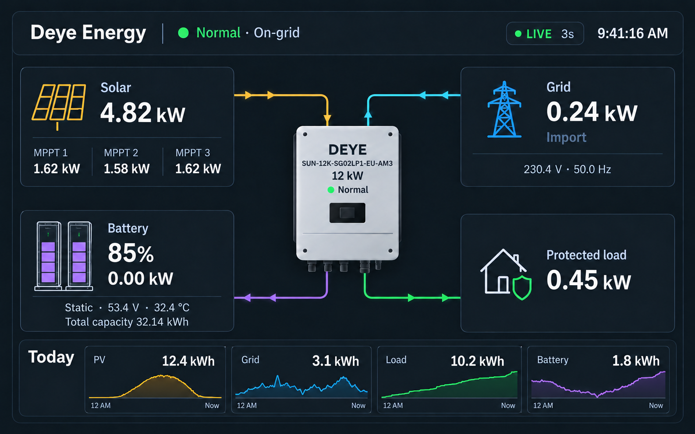

# PowerFlo

> Early implementation. Manual source-build installation is available. No GitHub remote or release is published yet; HACS distribution is not ready. Home Assistant 2026.10 is the intended commissioning environment, with live compatibility still to be validated.

PowerFlo is a read-only, live power-flow card for Home Assistant. Its configurable default display profile targets the Deye `SUN-12K-SG02LP1-EU-AM3` with a 32.14 kWh battery bank. The card reads existing Home Assistant entities and Recorder history; install and commission the inverter gateway separately.



*Design concept, not a commissioned Home Assistant screenshot. Current display surfaces are transparent.*

## Current status

PowerFlo is an early implementation. The state engine, reversible flow model, Recorder-history utilities, visual editor, responsive card shell, and unit tests exist. Live Deye commissioning, accessibility browser testing, and a tagged HACS release remain open.

## Safety boundary

PowerFlo reads Home Assistant entities. It does not connect to Modbus, call Home Assistant services, or write inverter settings.

## Features

- Dynamic `Static`, `Charging`, and `Discharging` battery status.
- Configurable battery and grid sign conventions.
- Reversible solar, grid, battery, and load arrows driven by current power state.
- Freshness-gated transform-only flow particles.
- Solar, Grid, Load, and Battery Today histories from Home Assistant Recorder.
- Editable title, inverter identity, ratings, clock format, and safe local raster image upload.
- 12-column Sections compatibility through `getGridOptions()`.
- Dark/light theme variables, narrow-card layout, and reduced-motion behavior.
- Plain JavaScript and JSDoc; no TypeScript toolchain.

## Transparent theme support

The outer card, inverter panel, flow nodes, and Today summaries have transparent backgrounds and no outer shadow. Your dashboard background or wallpaper shows through every panel. Text and borders use Home Assistant's `primary-text-color`, `secondary-text-color`, `divider-color`, and card border/radius variables, including custom themes. Flow colors retain their domain meaning. Uploaded inverter images retain their original background; use a transparent PNG or WebP for an image that blends into the dashboard.

## Required entities

| Mapping | Purpose |
|---|---|
| `freshness` | Boolean entity that is on/fresh while fast Modbus telemetry is current |
| `inverter_status` | Readable inverter status text from the integration |
| `grid_connected` | Boolean grid connection state |
| `solar_power` | Aggregate PV power in watts |
| `battery_soc` | Battery state of charge in percent |
| `battery_power` | Signed battery power in watts |
| `grid_power` | Signed grid power in watts |
| `load_power` | Protected-load power in watts |

PV channel values, voltage, temperature, frequency, and Today energy entities are recommended but optional.

## Installation

### Prerequisites

- A working Home Assistant instance and permission to manage dashboard resources.
- An inverter integration exposing all eight required mappings above, with power in **W** and SOC in **%**.
- A trustworthy freshness entity that switches off when telemetry stops. Do not substitute an always-on helper.
- Recorder enabled for daily-energy entities if you want historical sparklines.
- Node.js **22 or newer** and npm on your development computer to build PowerFlo. Node is not required on the Home Assistant server.

HACS is not required for manual installation. Live updates arrive when Home Assistant receives new entity values; the card does not increase your gateway's polling rate.

### 1. Build the installable bundle

From this project's local checkout:

```bash
cd /path/to/PowerFlo
npm ci
npm run verify
```

This runs lint, tests with coverage, and the production build. The file to install is `dist/powerflo-card.js`. Copy the built bundle rather than the individual `src/` files. The generated source map is optional.

### 2. Copy the bundle into Home Assistant

Use your usual file-management method to create `www/powerflo/` inside the active Home Assistant configuration directory, then copy the built JavaScript there:

```text
<configuration directory>/
└── www/
    └── powerflo/
        └── powerflo-card.js
```

On Home Assistant OS this is commonly `/config/www/powerflo/`. On a Container installation, use the host directory mounted as `/config`.

Files under `www/` are served at `/local/`. If you create `www/` for the first time, restart Home Assistant so it recognizes the directory. See the official [custom-card documentation](https://developers.home-assistant.io/docs/frontend/custom-ui/custom-card/).

### 3. Register the dashboard resource

For a dashboard managed through the UI:

1. Enable **Advanced mode** in your Home Assistant profile if Resources is hidden.
2. Open **Settings → Dashboards** and find **Resources** in the menu.
3. Add `/local/powerflo/powerflo-card.js?v=0.1.0` with type **JavaScript module**.
4. Save and reload the browser/dashboard.

For an existing YAML-managed dashboard resource configuration, merge this entry into your `lovelace.resources` list instead:

```yaml
lovelace:
  mode: yaml
  resources:
    - url: /local/powerflo/powerflo-card.js?v=0.1.0
      type: module
```

Use one registration method and avoid duplicates. Do not switch a UI dashboard to YAML mode just to install the card. Official guidance: [registering resources](https://developers.home-assistant.io/docs/frontend/custom-ui/registering-resources/).

### 4. Add and configure the card

Edit your dashboard, add a **Manual** card, and paste the configuration in the next section. Replace the example IDs with your actual entities from **Developer tools → States**.

All eight required mappings must be present. The empty starter configuration produces validation errors, so start with a Manual card. Once valid mappings are saved, the visual editor lets you change labels, capacities, images, clock format, flow behavior, and entity IDs.

### 5. Verify the live readings

Compare PowerFlo with Developer tools and the inverter display:

1. Confirm input power is in **W**, energy is in **kWh**, and temperature is in **°C**. PowerFlo does not inspect units or convert kW/Wh inputs.
2. Observe battery charging and discharging, then set `battery_positive` to match the signed power sensor.
3. Observe grid import/export, then set `grid_positive` accordingly.
4. Verify freshness switches off when telemetry stops and flow animation pauses.
5. Confirm your load mapping represents the protected-load output you intend to display.

### HACS installation status

HACS installation is not available yet. The repository has no published remote/release, and `dist/` is generated locally and excluded from Git. Before HACS distribution, the maintainer must publish an accessible repository, supply its built JavaScript in a supported distribution location, validate metadata/filename requirements, and test installation. See [HACS dashboard publishing requirements](https://www.hacs.xyz/docs/publish/plugin/).

## Development

```bash
npm ci
npm run verify
```

The build writes `dist/powerflo-card.js` and its source map.

## Minimal card configuration

Use Home Assistant's dashboard editor or resource API; never edit `.storage` directly.

```yaml
type: custom:powerflo-card
title: Deye Energy
inverter_name: DEYE
inverter_model: SUN-12K-SG02LP1-EU-AM3
inverter_capacity_kw: 12
battery_capacity_kwh: 32.14
clock_format: "12"
battery_positive: discharge
grid_positive: import
entities:
  freshness: binary_sensor.deye_modbus_flow_fresh
  inverter_status: sensor.deye_running_status
  grid_connected: binary_sensor.deye_grid_connected
  solar_power: sensor.deye_pv_power
  battery_soc: sensor.deye_battery_soc
  battery_power: sensor.deye_battery_power
  grid_power: sensor.deye_grid_power
  load_power: sensor.deye_inverter_output_power
```

Entity IDs above illustrate the required shape. Select the actual entities created by the commissioned gateway.

## Complete entity configuration

Use this example when the optional readings and daily counters exist. Omit optional mappings you do not have.

```yaml
type: custom:powerflo-card
title: Home energy
inverter_name: DEYE
inverter_model: SUN-12K-SG02LP1-EU-AM3
inverter_capacity_kw: 12
battery_capacity_kwh: 32.14
clock_format: "12"
flow_threshold_w: 40
flow_release_w: 20
battery_positive: discharge
grid_positive: import
entities:
  freshness: binary_sensor.deye_modbus_flow_fresh
  inverter_status: sensor.deye_running_status
  grid_connected: binary_sensor.deye_grid_connected
  solar_power: sensor.deye_pv_power
  pv1_power: sensor.deye_pv1_power
  pv2_power: sensor.deye_pv2_power
  pv3_power: sensor.deye_pv3_power
  battery_soc: sensor.deye_battery_soc
  battery_power: sensor.deye_battery_power
  battery_voltage: sensor.deye_battery_voltage
  battery_temperature: sensor.deye_battery_temperature
  grid_power: sensor.deye_grid_power
  grid_voltage: sensor.deye_grid_voltage
  grid_frequency: sensor.deye_grid_frequency
  load_power: sensor.deye_inverter_output_power
  solar_today: sensor.deye_solar_energy_today
  grid_today: sensor.deye_grid_import_energy_today
  load_today: sensor.deye_load_energy_today
  battery_today: sensor.deye_battery_discharge_energy_today
```

| Optional mapping | Unit | Meaning |
|---|---|---|
| `pv1_power`, `pv2_power`, `pv3_power` | W | Individual MPPT/channel power. |
| `battery_voltage` | V | Battery-bank voltage. |
| `battery_temperature` | °C | Reported battery temperature. |
| `grid_voltage` | V | Grid voltage. |
| `grid_frequency` | Hz | Grid frequency. |
| `solar_today` | kWh | Today's solar production energy. |
| `grid_today` | kWh | Selected daily grid counter, normally import. |
| `load_today` | kWh | Selected daily load counter. |
| `battery_today` | kWh | Selected daily battery counter, normally discharge. |

The card displays the counters you map; it does not calculate energy from power or combine charging/discharging totals. Choose daily-reset counters and document your selected grid/battery meanings. Missing optional numeric readings display `—`. The summary labels are fixed.

The inverter-status entity must contain readable text; raw register codes are not translated by PowerFlo. The card does not itself verify the integration's register map.

Boolean mappings accept `on`, `true`, `connected`, `1`, `yes`, or `fresh` as true, and `off`, `false`, `disconnected`, `0`, `no`, or `stale` as false, case-insensitively. Missing, unrecognized, unknown, or unavailable values are unavailable. For freshness, false produces **Stale**, and unavailable produces **Unavailable**; both stop flow motion.

## Customization

| Setting | Default | Accepted values / purpose |
|---|---|---|
| `title` | `Deye Energy` | Text, up to 60 characters. |
| `inverter_name` | `DEYE` | Text, up to 40 characters. |
| `inverter_model` | `SUN-12K-SG02LP1-EU-AM3` | Text, up to 80 characters. |
| `inverter_capacity_kw` | `12` | 0.1–1,000 kW; display metadata. |
| `battery_capacity_kwh` | `32.14` | 0.1–10,000 kWh; display metadata. |
| `inverter_image` | Empty | Built-in illustration when empty; supported local path or raster data URL otherwise. |
| `clock_format` | `"12"` | `"12"` for AM/PM or `"24"`; Home Assistant timezone. |
| `battery_positive` | `discharge` | `discharge` or `charge`: meaning of positive battery power. |
| `grid_positive` | `import` | `import` or `export`: meaning of positive grid power. |
| `flow_threshold_w` | `40` | Activation threshold, 1–5,000 W. |
| `flow_release_w` | `20` | Battery/grid release threshold, between 0 and the activation threshold. |

With `battery_positive: discharge`, +512 W means discharging and −512 W means charging. With `grid_positive: import`, positive power means grid → inverter; negative means inverter → grid. Arrowheads and moving particles follow these derived directions on the wide layout. Solar flows toward the inverter while producing; protected load flows away from it while powered.

Battery/grid hysteresis keeps an active direction until power magnitude falls below the release threshold, reducing flicker near zero. Solar/load use the activation threshold only. **Static** means no significant flow under the configured thresholds, rather than necessarily exactly zero watts.

### Inverter image

The visual editor's **Upload inverter image** accepts PNG, JPEG, or WebP up to **2 MB**, with dimensions no greater than **4096 × 4096**. It embeds the selected file as a data URL in the card configuration; it does not create a server-side image file.

Alternatively, copy a raster image into `www/powerflo/` and configure:

```yaml
inverter_image: /local/powerflo/inverter.png
```

Existing `/api/image/serve/` paths are also accepted. Remote image URLs and SVG uploads are not accepted. Use transparent PNG/WebP art to preserve the background. Do not place secrets in `www/`; Home Assistant serves `/local/` files without authentication.

### Battery expansion

Update `battery_capacity_kwh` when installed capacity changes. Capacity is manually configured, not discovered from the BMS. This version displays one aggregate bank; separate battery modules, module SOC, and balancing are not represented. Confirm your integration still exposes aggregate bank readings after expansion.

### Responsive layouts

The card implements both masonry sizing and Sections grid sizing. Use a wide card/section for the full topology. Below **50 rem of card-container width**, connectors and particles are hidden and nodes rearrange; below **32 rem**, nodes stack. Narrow layouts still display live values and battery/grid status, but currently do not show directional arrows.

## Today sparklines and Recorder

PowerFlo requests Recorder history from midnight in Home Assistant's timezone for the four `*_today` entities, then appends incoming live values. These lines show **daily energy counter history**, not instantaneous power curves. Ensure the mapped sensors are not excluded from [Recorder](https://www.home-assistant.io/integrations/recorder/).

At least two numeric points are needed for a line. A missing history response does not prevent the latest total from displaying. Recorder is queried on initial load and when the daily/entity key changes; it is not continuously re-fetched. Midnight rollover is triggered by subsequent Home Assistant state updates.

The current graph scales to available timestamps and does not invent a midnight sample when history begins later, despite the `12 AM` label. Fixed midnight-axis rendering and live midnight-rollover commissioning remain outstanding.

## Updates and removal

To update, build the new checkout with `npm ci` and `npm run verify`, replace the installed JavaScript, then change the resource query string to a fresh cache key, such as `?v=0.1.0-local2`. Reload the browser; refresh the companion app's frontend cache if it still uses the old bundle.

To remove PowerFlo, remove its cards, resource registration, installed JavaScript, and any images you no longer use. The inverter integration and entities remain independent of the card.

## Troubleshooting

| Symptom | Check |
|---|---|
| `Custom element doesn't exist: powerflo-card` | Open the resource URL. Confirm the bundle exists, is JavaScript, and is registered as a module. Reload with a new cache key. |
| Resource returns 404 | Verify the active config directory and `www/powerflo/` path; restart HA if `www/` was just created. |
| `Missing required entity` | Supply all eight mappings using the Manual card editor. |
| Reading shows `—` | Check the entity ID and numeric state in Developer tools. |
| Battery or grid direction is reversed | Correct `battery_positive` or `grid_positive` using real signed readings. |
| Status unavailable or motion paused | Check freshness, power sensor availability, thresholds, reduced motion, and whether the card/tab is visible. |
| Values differ by a factor of 1,000 | Inputs must be W and kWh. Convert kW/Wh upstream. |
| No arrows on a phone | The current layout hides connectors below 50 rem. Use a wider card for topology. |
| Today total works but no graph | Check optional daily mappings, Recorder history, and availability of two numeric points. |
| Image missing | Check supported type, size, dimensions, local URL, and file existence. |
| Background visible except behind artwork | The selected image may be opaque; use transparent PNG/WebP. |

For issue reports, include Home Assistant/browser versions, PowerFlo commit, sanitized configuration, entity units/states, and browser console errors. Never share tokens or credentials.

## Developer commands and fixture

| Command | Purpose |
|---|---|
| `npm run build` | Generate the browser bundle and source map. |
| `npm run dev` | Watch source changes and rebuild. |
| `npm run lint` | Run ESLint. |
| `npm test` | Run unit tests. |
| `npm run test:coverage` | Check core-module coverage. |
| `npm run verify` | Run lint, coverage, and build. |

After building, serve the repository root with a local HTTP server. If Python is installed:

```bash
python3 -m http.server 4173 --bind 127.0.0.1
```

Open `http://127.0.0.1:4173/demo/`. The fixture uses simulated values; it is not connected to an inverter.

```text
src/                 Card, editor, tokens, state, flow, history
test/                Core unit tests
demo/                Simulated browser fixture
assets/              Design mockup
dist/                Generated bundle, excluded from Git
graphify-out/         Code graph and extraction state
.github/workflows/    Verification configuration
PRD.md               Product scope
DESIGN.md            Design decisions
Task Checklist.md    Acceptance work
task-status.md        Progress
changelog.md          Changes
chatlog.md            Engineering record
```

See [SECURITY.md](SECURITY.md) for the read-only implementation boundary and [Task Checklist.md](Task%20Checklist.md) for outstanding verification.

## Repository technology

1. The build system is Rollup 4.
2. The frontend is a standards-based Web Component.
3. The language is modern JavaScript with JSDoc.
4. There is no backend or database.
5. Authentication is inherited from the Home Assistant frontend.
6. There is no payment system.
7. Distribution is designed for HACS and Home Assistant dashboard resources.
8. Verification runs through GitHub Actions.
9. Unit tests use Vitest 5 with Happy DOM.
10. The production card has zero runtime package dependencies.

## License

MIT
